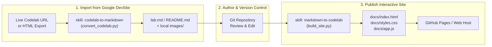

# glab

> **Bidirectional Google Codelabs ⟷ Markdown Toolkit & Agent Skills**

[](LICENSE)
[](https://www.python.org/)
[-success.svg)]()
[]()

**`glab`** is a dual-purpose toolkit and AI Agent Skill suite designed to bridge [Google Codelabs](https://codelabs.developers.google.com) and GitHub-Flavored Markdown (GFM). It provides two specialized, complementary skills:

1. **`codelab-to-markdown`**: Converts live or offline Google Codelabs into clean, version-controllable Markdown documents with locally downloaded images, normalized code blocks, and GitHub alerts.
2. **`markdown-to-codelab`**: Transforms any Markdown tutorial (`lab.md` or `README.md`) into a fully interactive, multi-step static website styled identically to official Google Codelabs, ready for instant publication on GitHub Pages.

Both skills are designed to work seamlessly with **Google Antigravity** and other AI coding assistants, as well as standalone CLI tools using standard Python (zero external dependencies).

---

## Architecture & Workflow



---

## What the Skills Can Be Used For

### 1. `codelab-to-markdown`

Use this skill when you need to ingest, archive, or edit Google Codelabs in Markdown format.

* **Archive & Version Control**: Turn ephemeral Google Codelab web pages into committed, reviewable Markdown documents (`lab.md` or `README.md`) in Git.
* **Offline Asset Extraction**: Automatically downloads all content images and diagrams concurrently to a local directory (e.g. `./images`) and rewrites image links to relative paths. DevSite navigation icons, badges, and UI chrome are automatically filtered out.
* **DevSite Syntax Normalization**: Converts proprietary DevSite custom HTML tags (`<google-codelab>`, `<google-codelab-step>`, `<devsite-code>`) into clean heading hierarchies and fenced code blocks.
* **Heuristic Syntax Tagging**: Fixes common DevSite syntax misattributions (such as shell scripts tagged as `Text only` or JSON configs tagged as `Transact-SQL`) into proper `bash`, `json`, `yaml`, `python`, etc.
* **GitHub Alert Formatting**: Converts `<aside class="special">` and `<aside class="warning">` blocks into standard GitHub Flavored Markdown alerts (`> [!NOTE]`, `> [!WARNING]`).
* **Source Attribution**: Injects a clean reference note in the first step linking back to the original Google Codelab URL.

### 2. `markdown-to-codelab`

Use this skill when you want to turn Markdown tutorials into engaging, interactive developer labs.

* **GitHub Pages Publication**: Compiles Markdown files into a self-contained static site inside `docs/` (`index.html`, `styles.css`, `app.js`, and `images/`) that can be served directly from GitHub Pages or any static host.
* **Authentic Google Codelabs Experience**: Features the official Google Sans / Material theme, header bar, colored step emblems, and responsive aside callout boxes (`> [!NOTE]`, `> [!WARNING]`, `> [!TIP]`).
* **Interactive Step Navigation**: Includes an interactive drawer sidebar, real-time step filtering/search, next/back step navigation buttons, and step counter badge (`Step X of Y`).
* **Deep Linking & State Persistence**: Preserves active step numbers in the URL hash (`#0`, `#1`) for direct sharing, and remembers the reader's last visited step via `localStorage`.
* **Keyboard Shortcuts & Progress Bar**: Allows moving through steps with `ArrowRight` and `ArrowLeft` keys, with a dynamic progress bar tracking completion percentage.
* **Copy-to-Clipboard Code Blocks**: Renders every code block with a syntax pill and a one-click copy button with animated feedback.

---

## How to Install the Skills

### Method 1: Antigravity / Gemini CLI Agent

#### A. Project-Level (Current Workspace)
To use the skills within this project or copy them into an existing workspace:

1. Clone or copy the `skills/` directory into your project's customization root:
   ```bash
   # Copy into your project's .agents directory
   mkdir -p .agents/skills
   cp -r /path/to/glab/skills/* .agents/skills/
   ```
2. Antigravity will automatically detect `codelab-to-markdown` and `markdown-to-codelab` through hierarchical discovery.

#### B. Global Installation (Available Across All Projects)
To make both skills available across all workspaces on your machine:

```bash
# For Antigravity CLI / Gemini CLI
mkdir -p ~/.gemini/antigravity-cli/skills
cp -r skills/codelab-to-markdown ~/.gemini/antigravity-cli/skills/
cp -r skills/markdown-to-codelab ~/.gemini/antigravity-cli/skills/
```

*(Alternatively, symlink them so updates in your `glab` clone take effect immediately)*:
```bash
ln -s "$(pwd)/skills/codelab-to-markdown" ~/.gemini/antigravity-cli/skills/codelab-to-markdown
ln -s "$(pwd)/skills/markdown-to-codelab" ~/.gemini/antigravity-cli/skills/markdown-to-codelab
```

---

### Method 2: Standalone CLI (Without an AI Agent)

The underlying Python scripts have **zero external dependencies** and run directly with standard Python 3.10+:

1. Clone the repository:
   ```bash
   git clone https://github.com/craigivy/glab.git
   cd glab
   ```
2. Verify Python 3 is installed:
   ```bash
   python3 --version
   ```
3. (Optional) Create aliases or add the scripts directory to your `PATH` in `~/.zshrc` or `~/.bashrc`:
   ```bash
   alias codelab2md="python3 $(pwd)/skills/codelab-to-markdown/scripts/convert_codelab.py"
   alias md2codelab="python3 $(pwd)/skills/markdown-to-codelab/scripts/build_site.py"
   ```

---

## How to Use the Skills

### Option A: Using with Antigravity / AI Agent

When the skills are installed, Antigravity uses **progressive disclosure** to automatically load the skill instructions when you prompt it with related tasks:

#### 1. Converting a Codelab to Markdown
Prompt the agent:
> *"Convert this Google Codelab into a lab.md: `https://codelabs.developers.google.com/getting-started-google-antigravity`"*

The agent will:
- Activate `codelab-to-markdown`.
- Execute `convert_codelab.py`.
- Download images to `./images`.
- Verify the step hierarchy and generate `lab.md`.

#### 2. Building a Codelab Website from Markdown
Prompt the agent:
> *"Build an interactive Google Codelab website in `docs/` from my `lab.md`."*

The agent will:
- Activate `markdown-to-codelab`.
- Execute `build_site.py`.
- Generate `docs/index.html`, `docs/styles.css`, `docs/app.js`, and copy referenced media assets.

#### 3. Full Round-Trip / Rehosting
Prompt the agent:
> *"Download the codelab from `https://codelabs.developers.google.com/...`, let me review the steps in markdown, and then build a static site ready for GitHub Pages in `docs/`."*

---

### Option B: Using via Command Line (CLI)

#### 1. `convert_codelab.py` (Codelab → Markdown)

##### Convert from a Live URL
```bash
python3 skills/codelab-to-markdown/scripts/convert_codelab.py \
  "https://codelabs.developers.google.com/getting-started-google-antigravity" \
  --output lab.md \
  --images-dir images
```

##### Convert from a Local HTML File
If you have saved or curled the HTML page locally:
```bash
python3 skills/codelab-to-markdown/scripts/convert_codelab.py \
  scratch/codelab.html \
  --output lab.md \
  --images-dir images \
  --base-url "https://codelabs.developers.google.com"
```

##### CLI Options for `convert_codelab.py`
| Argument | Flag | Default | Description |
| :--- | :--- | :--- | :--- |
| `source` | *(positional)* | *Required* | Codelab live HTTPS URL or path to a local `.html` file |
| Output Path | `-o`, `--output` | `lab.md` | Target destination for the generated Markdown file |
| Images Directory | `--images-dir` | `./images` | Directory where downloaded images will be stored |
| Base URL | `--base-url` | Auto-detected | Base URL used to resolve relative `/static/...` image links |
| Skip Images | `--skip-images` | `false` | Skips downloading images locally and preserves remote URLs |

---

#### 2. `build_site.py` (Markdown → Codelab Website)

##### Default Build (`lab.md` → `docs/`)
If `lab.md` exists in your working directory, run without arguments:
```bash
python3 skills/markdown-to-codelab/scripts/build_site.py
```
*(If `lab.md` is absent, the script automatically falls back to `README.md`).*

##### Custom Input and Output Directory
```bash
python3 skills/markdown-to-codelab/scripts/build_site.py tutorial.md \
  --output-dir site \
  --title "Custom Codelab Title" \
  --author "Your Name" \
  --duration 45
```

##### Preview the Generated Site Locally
```bash
# Serve the docs/ directory on http://localhost:8000
python3 -m http.server -d docs 8000
```
Open `http://localhost:8000` in your web browser.

##### Deploying to GitHub Pages
1. Push your repository to GitHub.
2. In your GitHub repository settings, navigate to **Settings** → **Pages**.
3. Under **Build and deployment**, set:
   - **Source**: `Deploy from a branch`
   - **Branch**: `main` (or default branch) / `/docs` folder.
4. Click **Save**. Your interactive codelab will be live at `https://<username>.github.io/<repo>/`.

##### CLI Options for `build_site.py`
| Argument | Flag | Default | Description |
| :--- | :--- | :--- | :--- |
| `input` | *(positional)* | `lab.md` (or `README.md`) | Input Markdown file path |
| Input File | `-i`, `--input-file` | `None` | Alternative flag to specify input Markdown path |
| Output Directory | `-o`, `--output-dir` | `docs` | Target directory for the static site |
| Title Override | `--title` | Auto-detected | Overrides the codelab title in the header and metadata |
| Author Override | `--author` | Auto-detected | Overrides the author name in the header card |
| Duration Override | `--duration` | Auto-detected | Overrides total duration in minutes |
| Original URL | `--original-url` | Auto-detected | Link to the original source codelab |

---

## Repository Structure

```text
glab/
├── LICENSE                                # Apache 2.0 License
├── README.md                              # Project documentation (this file)
└── skills/
    ├── codelab-to-markdown/               # Skill: Google Codelab -> Markdown
    │   ├── SKILL.md                       # Antigravity skill definition & instructions
    │   ├── references/
    │   │   └── codelab-format.md          # DevSite custom element specification
    │   └── scripts/
    │       └── convert_codelab.py         # Converter CLI script
    │
    └── markdown-to-codelab/               # Skill: Markdown -> Google Codelab Web Site
        ├── SKILL.md                       # Antigravity skill definition & instructions
        ├── references/
        │   └── template-guide.md          # Static site architecture & style reference
        └── scripts/
            └── build_site.py              # Static site generator CLI script
```

---

## Requirements

- **Python 3.10+**
- **No external Python packages required** (uses standard library modules: `urllib`, `ssl`, `json`, `re`, `html`, `argparse`, `shutil`, `concurrent.futures`).
- Compatible with macOS, Linux, and Windows.

---

## License

This project is licensed under the Apache 2.0 License. See the [LICENSE](LICENSE) file for details.
